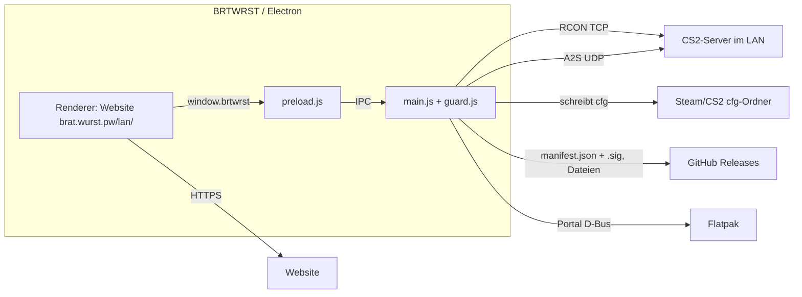

# Architektur – brtwrst-app

Stand: Commit `d167099` (Version 0.1.7, 2026-11-09). Belege als Dateipfade.

## Überblick

## Prozesse und Verantwortung
- **Hauptprozess** (`src/main.js`): ein Fenster (Single-Instance-Lock), Fenstergröße in
  `<userData>/fenster.json`, Menü (Alt blendet ein), Navigation: eigene URLs bleiben im Fenster, alles andere
  geht in den System-Browser. Bei Ladefehler `src/offline.html`.
- **Preload** (`src/preload.js`): fragt synchron `brtwrst:is-own` und stellt nur dann `window.brtwrst` bereit.
- **Guard** (`src/guard.js`): `START_URL` (`BRTWRST_URL` oder `https://brat.wurst.pw/lan/`), `ALLOWED`-Origins,
  `isLanAddr`, `validCmds`.
- **RCON** (`src/rcon.js`): eine TCP-Verbindung pro Auftrag, Befehle nacheinander; Multi-Paket-Antworten werden
  über volle Pakete (≥ 3800 Zeichen), ein Markierungspaket oder Ruhepausen erkannt. Timeout 5 s.
- **Scan** (`src/scan.js`): A2S_INFO an alle Server parallel (3 s, Challenge-Antwort), danach `maps *` per RCON
  an bis zu 3 Server (Passwort = Hausnummer aus dem Servernamen). `a2sPlayers` für A2S_PLAYER (1,5 s).
- **GSI** (`src/gsi.js`): Steam-Pfade (Windows-Registry + Standardpfade; Linux nativ, Flatpak-Steam, Snap),
  `libraryfolders.vdf`, schreibt `gamestate_integration_brtwrst.cfg` in jeden gefundenen CS2-cfg-Ordner.
- **Berechtigungen**: nur `clipboard-sanitized-write` für eigene Seiten (`permissions()` in `src/main.js`).

## Datenhaltung
Keine eigene Datenhaltung außer `<userData>/fenster.json`, `<userData>/update.log` und `<userData>/updates/`
(heruntergeladene Updates, macOS `alt.app`). Alle Inhaltsdaten liegen bei der Website.

## Updates (`src/updater.js`, `src/main.js`)
- Nur paketiert (oder mit `BRTWRST_UPDATE_URL`): 10 s nach Start, dann alle 4 h, plus Menü „Nach Updates suchen“.
- Quelle: `https://github.com/bauerrrrrrr/brtwrst-app/releases/latest/download/manifest.json` + `.sig`.
- Ablauf: Signatur prüfen (Ed25519, `src/update-key.js`) → nur höhere Version → Datei je Ziel laden →
  Größe + SHA-256 prüfen → Nachfrage → Tausch:
  `nsis` (Installer `/S`), `mac` (ZIP per `ditto`, `.app` tauschen), `appimage` (Datei ersetzen, `.bak`),
  `flatpak` (Portal-UpdateMonitor, `src/flatpak.js`), sonst `manual` (Hinweis mit Download-Link).

## Release (`.github/workflows/release.yml`)
Push auf `main` (oder Tag `v*.*.*`, der zu `package.json` passen muss) → `version` (neuer Tag?) → `test` → `build` (Linux/Windows/macOS-Matrix,
ohne Code-Signatur) → `flatpak` (bauen, GPG-signieren, GitHub Pages) → `release` (`scripts/manifest.js`
signiert das Manifest, `gh release create`; existiert das Release schon, nur `upload`/`edit`). Das Flatpak-Repo ist aktualisiert, bevor das Manifest erscheint.
`flatpak-check.yml` baut/installiert das Flatpak bei Änderungen an `flatpak/`, `scripts/flatpak-build.sh`, `package.json` (also praktisch bei jedem Release-Commit) oder am Workflow selbst testweise, ohne Veröffentlichung.

## Notizen zu Entscheidungen
- macOS nur Apple Silicon (Commit `eb8724c`), Intel bewusst nicht.
- Startadresse `brat.wurst.pw/lan/` statt `lan.brat.wurst.pw` (Commit `43d2fe7`; Subdomain ohne HTTPS, nur geplant).
- Kein Code-Signing-Zertifikat: Windows/macOS warnen beim ersten Start (Release-Notizen im Workflow).
